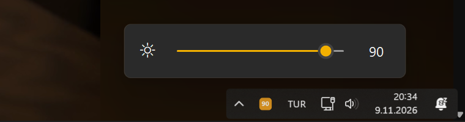

<p align="center"></p>

# SoftBright

[](https://github.com/harunsariaslan7/SoftBright/releases/latest)
[](https://buymeacoffee.com/harunsariaslan)
[](LICENSE)

**Brightness control for monitors that ignore DDC/CI**, such as the Samsung Odyssey OLED G8 (G85SB).
Lives in the Windows system tray and behaves exactly like the volume icon: scroll the mouse wheel
over the icon to change brightness, click it for a slider flyout, or use global hotkeys.

*Türkçe açıklama aşağıda.*



## Why

Tools like Twinkle Tray or Monitorian talk to the monitor over **DDC/CI**. Some monitors, including the
Samsung Odyssey OLED G8 (G85SB), simply do not answer (Windows reports error 31, "device not functioning"),
so none of those tools can change their brightness.

SoftBright takes a different route: it applies a full-screen color transform through the Windows
**Magnification API**, the same mechanism Windows uses for its own Color Filters. On an OLED panel every
pixel emits its own light, so scaling the signal is practically the same as lowering hardware brightness:
blacks stay black, whites get dimmer. The gamma-ramp approach was rejected because Windows clamps it at 50%.

## Install

1. Download `SoftBright.exe` from the [latest release](https://github.com/harunsariaslan7/SoftBright/releases/latest).
2. Put it anywhere and run it. No installer; .NET Framework 4.8 ships with Windows 10/11.
3. Optionally enable **Start with Windows** in the right-click menu.

> **SmartScreen:** the executable is not code-signed, so Windows may warn on first launch.
> Click "More info" → "Run anyway", or build it yourself from source (see below). Every release lists the
> SHA-256 of the published file.

## Usage

| Action | Result |
| --- | --- |
| Mouse wheel over the tray icon | ±5 brightness, small flyout appears and fades |
| Left click | Slider flyout (drag, wheel, arrow keys) |
| Right click | Presets, start with Windows, donate, exit |
| `Ctrl+Alt+↑` / `Ctrl+Alt+↓` | ±5 from anywhere |
| `Ctrl+Alt+Home` / `Ctrl+Alt+End` | 100% / minimum (5%) |

The last level is stored in `%APPDATA%\SoftBright\settings.txt` and restored on start.
`step=` sets the hotkey step, `wheelstep=` the wheel step. Brightness returns to 100% when the app exits,
even if it crashes.

The UI is in English, or in Turkish when Windows is set to Turkish.

### Keeping the icon next to the volume icon (Windows 11)

Windows 11 puts new tray icons into the hidden overflow by default. On first run SoftBright marks its own
entry under `HKCU\Control Panel\NotifyIconSettings` as `IsPromoted=1`. On some builds (seen on 26H2)
Explorer does not pick this up by itself; flip the switch once and it sticks:

**Settings → Personalization → Taskbar → Other system tray icons → SoftBright.exe**, or drag the icon out
of the overflow onto the taskbar.

## Privacy and security

- **No network access.** The app never connects to anything; the only URLs it knows are the donate and
  project links in the menu, opened in your browser only when you click them.
- **No telemetry, no background services, no installer.** One executable, one settings file.
- **Low-level mouse hook** (`WH_MOUSE_LL`): used only to see mouse-wheel events, and only to check whether
  the cursor is over the tray icon. No keyboard hook, nothing is logged or stored.
- **Registry:** writes only to the current user: its own entry under `NotifyIconSettings` (icon visibility)
  and, if you enable it, the `Run` key for autostart.
- **Build it yourself:** `build.ps1` compiles the single source file with the C# compiler that ships with
  Windows. No SDK, no NuGet packages, no third-party code.

## Build

```
powershell -ExecutionPolicy Bypass -File build.ps1
```

Produces `SoftBright.exe` (and `app.ico`, which is only embedded into the exe).

## Limitations

- Software dimming: the monitor's own OSD brightness value does not change.
- With Windows **HDR** enabled, and in some **exclusive-fullscreen** games, the desktop compositor is
  bypassed and the effect may not apply.
- Windows' built-in Color Filters (Win+Ctrl+C) use the same mechanism, so the two cannot be combined.

## Support

If SoftBright is useful to you, you can buy me a coffee: **[buymeacoffee.com/harunsariaslan](https://buymeacoffee.com/harunsariaslan)** ☕

---

## Türkçe

**DDC/CI desteklemeyen monitörler için parlaklık kontrolü.** Samsung Odyssey OLED G8 (G85SB) gibi bazı
monitörler Twinkle Tray, Monitorian vb. uygulamaların gönderdiği DDC/CI komutlarına hiç cevap vermez
(Windows hata 31 döndürür). SoftBright bunun yerine Windows Magnification API ile ekran kartından çıkan
görüntüye tam ekran renk matrisi uygular; Windows'un kendi Renk Filtreleri ile aynı mekanizmadır. OLED'de her
piksel kendi ışığını ürettiği için sonuç gerçek parlaklık ayarına çok yakındır.

**Kurulum:** [Releases](https://github.com/harunsariaslan7/SoftBright/releases/latest) sayfasından `SoftBright.exe`
dosyasını indirip çalıştırın. Kurulum gerektirmez. İmzasız olduğu için SmartScreen uyarı verebilir:
"Ek bilgi" → "Yine de çalıştır".

**Kullanım (ses simgesi gibi):**

- Tepsi simgesi üzerinde **fare tekerleği**: 5'er artır / azalt, küçük flyout belirir ve kendiliğinden kapanır.
- **Sol tık**: kaydırıcılı flyout. **Sağ tık**: hazır seviyeler, Windows ile başlat, bağış, çıkış.
- `Ctrl+Alt+↑` / `↓`: 5'er artır / azalt. `Ctrl+Alt+Home` / `End`: %100 / en düşük.
- Son seviye `%APPDATA%\SoftBright\settings.txt` dosyasında saklanır. Çıkışta ekran %100'e döner.

**Simge ses simgesinin yanında durmuyorsa:** Ayarlar → Kişiselleştirme → Görev çubuğu → Diğer sistem tepsisi
simgeleri altında `SoftBright.exe` anahtarını bir kez açın; ayar kalıcıdır.

**Gizlilik:** İnternete bağlanmaz, veri toplamaz. Fare kancası yalnızca tekerlek olaylarını simgenin üzerinde
mi diye kontrol eder. Kayıt defterinde yalnızca kendi tepsi simgesi girdisine ve (siz açarsanız) açılışta
başlatma anahtarına yazar. Tek kaynak dosyadan Windows'un kendi derleyicisiyle derlenir.

**Destek:** [buymeacoffee.com/harunsariaslan](https://buymeacoffee.com/harunsariaslan) ☕
